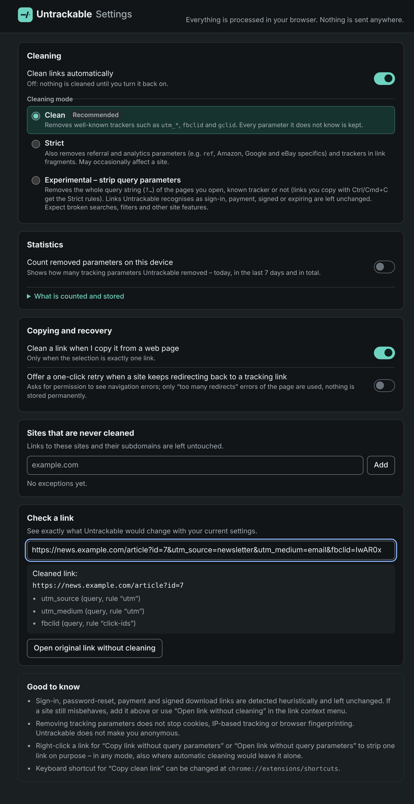
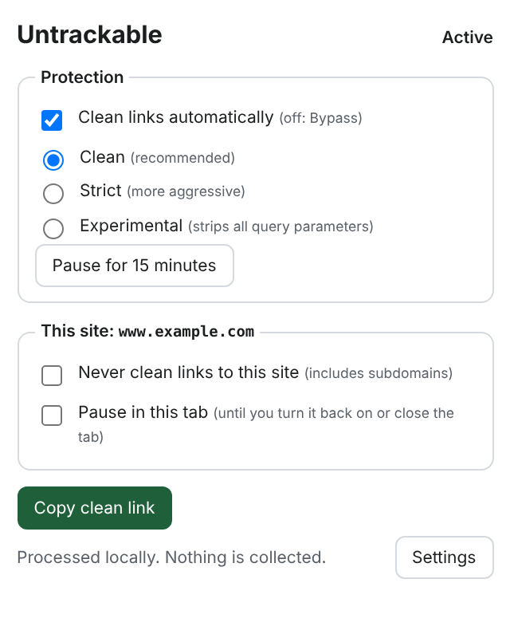

# Untrackable

**Privacy by default. Zero friction.**

Untrackable removes tracking parameters from links – automatically, locally,
and without breaking sign-ins, purchases or signed downloads.

```
https://example.com/article?utm_source=newsletter&utm_medium=email&id=123
                                       ↓
https://example.com/article?id=123
```

Status: **v0.1.0 release candidate** – Chromium extension (Phase 1). Not yet
published in the Chrome Web Store.

## Features

- **Automatic navigation cleaning** – known trackers (`utm_*`, `fbclid`,
  `gclid`, `msclkid`, `mc_cid`, HubSpot, Marketo, YouTube/Spotify `si`, …)
  are removed before the request leaves your browser.
- **Copy cleaning** – copy a link from a page and you get the clean link.
- **Copy clean link** – context-menu items for links and pages, and the
  shortcut <kbd>Alt</kbd>+<kbd>Shift</kbd>+<kbd>U</kbd>.
- **Functionality first** – sign-in (OAuth, OpenID Connect, SAML), password
  reset, e-mail verification, invitations, signed/expiring downloads (S3,
  GCS, Azure, CloudFront) and payment pages are detected and left untouched.
  Unknown parameters are always kept.
- **Three modes** – _Clean_ (default), _Strict_ (more aggressive, optional),
  _Bypass_ (off).
- **You stay in control** – per-site exceptions, pause for 15 minutes, pause
  in a single tab, "Open link without cleaning" for one-off bypasses.
- **Transparent** – the settings page shows exactly which parameters would be
  removed from a link and why.
- **Local only** – no telemetry, no network requests, no browsing data stored.

## Screenshots

| Settings with link preview               | Popup                           |
| ---------------------------------------- | ------------------------------- |
|  |  |

## Installation (developer build)

```sh
git clone <this repository> untrackable && cd untrackable
npm ci
npm run build
```

Then open `chrome://extensions`, enable **Developer mode**, click **Load
unpacked** and select `apps/browser-extension/dist`.
A packaged zip can be created with `npm run package -w apps/browser-extension`
(written to `artifacts/`); CI also uploads it as a build artifact.

Supported browsers: Chromium-based browsers version 116 or newer (Chrome,
Edge, Brave, Vivaldi, Opera). Only Chromium is tested automatically.

## Usage

Nothing to do – links are cleaned as you browse. The toolbar popup offers:

| Control                        | Effect                                        |
| ------------------------------ | --------------------------------------------- |
| Clean links automatically      | Global on/off (Bypass mode when off)          |
| Clean / Strict                 | Choose the cleaning mode                      |
| Pause for 15 minutes           | Temporary bypass, resumes automatically       |
| Never clean links to this site | Adds a domain exception (subdomains included) |
| Pause in this tab              | Bypass for one tab until re-enabled or closed |
| Copy clean link                | Copies the current page's clean link          |

The badge shows `S` in Strict mode and `off` when cleaning is off or paused.
Right-click a link for **Copy clean link** and **Open link without cleaning**.

## Cleaning modes

| Mode                | Removes                                                                                                                                                                  | Notes                                                                        |
| ------------------- | ------------------------------------------------------------------------------------------------------------------------------------------------------------------------ | ---------------------------------------------------------------------------- |
| **Clean** (default) | Campaign parameters (`utm_*`), ad click ids, newsletter/marketing ids, share ids on YouTube, Spotify, Instagram, X                                                       | Designed to never break sites                                                |
| **Strict**          | Everything in Clean plus referral/analytics parameters (`ref`, Matomo `pk_*`/`mtm_*`, …), Amazon/Google/eBay/AliExpress/social specifics, and trackers in link fragments | Unknown parameters are still kept                                            |
| **Bypass**          | Nothing                                                                                                                                                                  | Global off, timed pause, per-tab pause, one-time bypass, per-site exceptions |

The full list lives in [`rules/rules.json`](rules/rules.json).

## Known limitations

- **Not anonymity.** Cookies, IP addresses, fingerprinting and tracking
  scripts are unaffected.
- Navigation cleaning uses Chromium's `declarativeNetRequest`. Mixed-case
  spellings (`Utm_Source`) and unlisted `utm_*` names are handled;
  URLs with percent-encoded letters, digits or `-._/` in the path or in any
  parameter name are left alone while navigating (copy cleaning handles
  them). When Chromium removes a parameter it may write a valueless parameter
  as `edit=` instead of `edit`. Mixed-case or unknown trackers in URLs with 7+
  parameters are only cleaned when copying. Only top-level navigations are
  cleaned.
- If a site redirects back to a tracking link, Chromium reports "too many
  redirects". Enable the _retry offer_ in the settings (optional permission;
  then click "Retry once without cleaning" in the popup) or use a site
  exception.
- Copy cleaning works with the keyboard shortcut (Ctrl/Cmd+C). Copying via
  the browser's menus is not cleaned – use "Copy clean link" instead.
- Protection of sign-in/payment/signed links is heuristic. If a site
  misbehaves, add an exception or use _Open link without cleaning_.
- Copy cleaning only applies when the copied selection is exactly one link,
  and cannot intercept the browser's own UI (use the context menu instead).
- Redirect-based click tracking (`tracker.example/click?u=…`) is not handled yet.

Details: [architecture overview](docs/architecture/overview.md).

## Privacy

Untrackable processes everything locally, makes no network requests, collects
no telemetry and stores only your settings. See [docs/privacy](docs/privacy/privacy.md)
and the [threat model](docs/security/threat-model.md).

## Development

```sh
npm ci
npm run check        # format, lint, types, unit tests, build
npm run test:e2e     # real Chromium end-to-end tests
cargo test --all     # Rust engine
```

See [docs/development.md](docs/development.md) and [CONTRIBUTING.md](CONTRIBUTING.md).

### Project layout

| Path                        | Content                                               |
| --------------------------- | ----------------------------------------------------- |
| `rules/rules.json`          | Tracker and protection rules (single source of truth) |
| `packages/core`             | TypeScript engine + declarativeNetRequest compiler    |
| `crates/untrackable-core`   | Rust engine for future desktop apps (+ CLI example)   |
| `apps/browser-extension`    | Chromium MV3 extension and e2e tests                  |
| `tests/fixtures/cases.json` | Shared conformance cases for both engines             |
| `docs/`                     | Architecture, engine spec, security, privacy, roadmap |

## Roadmap

1. **Chromium extension** – this release.
2. **macOS & Linux** – desktop URL handler built on the Rust engine.
3. **Advanced privacy** – redirect tracking, custom rules, Firefox.

See [docs/roadmap](docs/roadmap/roadmap.md).

## License

[MIT](LICENSE)
