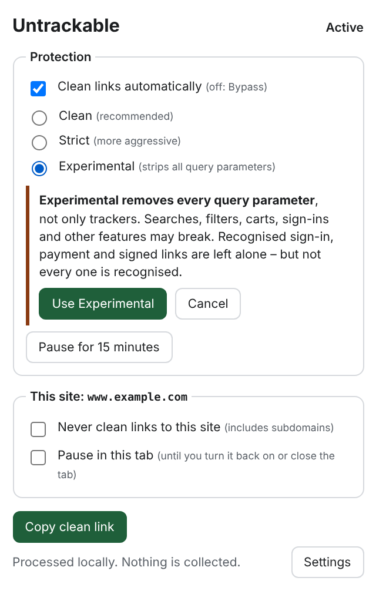

# Untrackable

**Privacy by default. Zero friction.**

Untrackable is a browser extension for Chromium-based browsers that removes
tracking parameters from links – automatically, on your device, before a page
is requested.

```
https://example.com/article?utm_source=newsletter&utm_medium=email&id=123
                                       ↓
https://example.com/article?id=123
```

Marketing links often carry identifiers such as `utm_*`, `fbclid` or `gclid`
that tell a site where you came from. Untrackable strips the ones it knows and
keeps everything else, so the page still works.

- **Automatic** – links are cleaned while you browse; there is nothing to set up.
- **Conservative by default** – the default _Clean_ mode only removes known
  trackers. Unknown parameters are always kept.
- **Careful with what matters** – links that look like sign-ins, password
  resets, payments or signed downloads are recognised and left unchanged.
- **Local and private** – no telemetry, no network requests, no browsing
  history. Only your settings are stored.
- **Transparent and under your control** – see what would be removed from any
  link, switch modes, pause, or exclude sites.

> **Current release: [v0.2.0](https://github.com/Estefanolabudda/untrackable/releases/tag/v0.2.0)**
> – available as a ZIP on GitHub Releases for manual installation. Untrackable
> is **not** available in the Chrome Web Store.

## Contents

- [Screenshots](#screenshots)
- [Installation](#installation)
- [Cleaning modes](#cleaning-modes)
- [Experimental mode](#experimental-mode)
- [Using Untrackable](#using-untrackable)
- [How links are protected](#how-links-are-protected)
- [Privacy](#privacy)
- [Known limitations](#known-limitations)
- [Documentation](#documentation)
- [Development](#development)
- [Roadmap](#roadmap) · [Security](#security) · [License](#license)

## Screenshots

| Popup                                         | Switching to Experimental                                                     | Settings with link check                      |
| --------------------------------------------- | ----------------------------------------------------------------------------- | --------------------------------------------- |
|        |  |      |
| Mode, pause and per-site controls at a glance | Experimental is only switched on after an explicit confirmation               | Exceptions and a preview of what gets removed |

## Installation

Requires a Chromium-based browser, version 116 or newer: Chrome, Edge, Brave,
Vivaldi or Opera. Automated tests run on Chromium; the maintainer tests releases
on Chrome for macOS.

### From the GitHub release (recommended)

1. Open the [latest release](https://github.com/Estefanolabudda/untrackable/releases/latest)
   and download **`untrackable-chromium-0.2.0.zip`**.
2. Unzip it into a folder you will keep, for example `Untrackable`. The files
   (`manifest.json`, `background.js`, …) sit directly in the ZIP, so unzipping
   on the command line needs a target folder:
   `unzip untrackable-chromium-0.2.0.zip -d Untrackable`.
3. Open `chrome://extensions` (in Edge: `edge://extensions`).
4. Turn on **Developer mode**.
5. Click **Load unpacked** and select the folder that contains `manifest.json`.
6. Optional: pin Untrackable to the toolbar via the puzzle-piece menu.

Keep the folder where it is – the browser loads the extension from it.

**Updating:** download the new ZIP, replace the contents of the same folder and
click the reload icon on Untrackable's card in `chrome://extensions`. Loading
from the same folder normally keeps your settings.

#### Verify the download (optional)

Each release lists the SHA-256 checksum of the ZIP in its notes and in the
attached `SHA256SUMS` file. For v0.2.0 it is:

```
d3b4dca2fc9fc7948401e123c4b756653081dd616c256c74695eef04d5f62a65  untrackable-chromium-0.2.0.zip
```

```sh
shasum -a 256 untrackable-chromium-0.2.0.zip      # macOS
sha256sum -c SHA256SUMS                          # Linux (SHA256SUMS next to the ZIP)
Get-FileHash untrackable-chromium-0.2.0.zip      # Windows PowerShell
```

The ZIP is built reproducibly by the release workflow from the tagged commit,
so you can also rebuild it from source and compare (see
[docs/development.md](docs/development.md)).

### From source

```sh
git clone https://github.com/Estefanolabudda/untrackable.git
cd untrackable
npm ci
npm run build
```

Then load `apps/browser-extension/dist` as an unpacked extension (steps 3–5
above). `npm run package -w apps/browser-extension` writes the same ZIP as the
release to `artifacts/`.

### Permissions

At installation Chrome shows two warnings:

| Warning                                         | Why Untrackable needs it                                                                                                                                                                                                      |
| ----------------------------------------------- | ----------------------------------------------------------------------------------------------------------------------------------------------------------------------------------------------------------------------------- |
| _Read and change all your data on all websites_ | Rewriting navigation URLs requires host access, and copy cleaning runs on every page. When you copy with the keyboard, Untrackable only checks whether the copied text is a single link; it does not read other page content. |
| _Modify data you copy and paste_                | Writing the clean link to the clipboard when you copy a link or use "Copy clean link".                                                                                                                                        |

The redirect-loop helper uses the optional `webNavigation` permission. It is
off by default and only requested when you enable it in the settings. Details:
[threat model – permissions](docs/security/threat-model.md#permissions-and-justification).

## Cleaning modes

| Mode                             | What it removes                                                                                                                                                                                                                                                                            | When to use it                                                   |
| -------------------------------- | ------------------------------------------------------------------------------------------------------------------------------------------------------------------------------------------------------------------------------------------------------------------------------------------ | ---------------------------------------------------------------- |
| **Clean** (default, recommended) | Known trackers only: campaign parameters (`utm_*`), ad click IDs (`fbclid`, `gclid`, `msclkid`, …), newsletter and marketing IDs (Mailchimp, HubSpot, Marketo, …) and share IDs on YouTube, Spotify, Instagram and X. **Unknown parameters are always kept.**                              | Everyday browsing. Designed to be conservative.                  |
| **Strict**                       | Everything in Clean, plus referral and analytics parameters (`ref`, Matomo `pk_*`/`mtm_*`, …), site-specific trackers for Amazon, Google search, eBay, AliExpress and social networks; when copying, also trackers in link fragments (`#utm_source=…`). Unknown parameters are still kept. | More removal, with a slightly higher chance that a site notices. |
| **Experimental** (opt-in)        | The **entire query string** (`?…`) of the pages you open – trackers, functional and unknown parameters alike. Recognised sign-in, payment and signed links are left unchanged. See [Experimental mode](#experimental-mode).                                                                | Maximum URL minimisation when you accept that sites will break.  |
| **Bypass**                       | Nothing. Turn off "Clean links automatically", pause for 15 minutes, pause a single tab, open one link without cleaning, or add a site exception.                                                                                                                                          | When a site misbehaves, or you want links unchanged.             |

The complete list of trackers and protection signals is in
[`rules/rules.json`](rules/rules.json).

## Experimental mode

> **Experimental is experimental.** It is off by default, asks for
> confirmation before it is switched on, and **will break some sites**. It
> minimises URLs; it does not make you anonymous.

**What it does.** Experimental removes the whole query string of the pages
you open, whatever the parameters are called:

```
https://example.com/article?utm_source=email&id=123&ref=newsletter
                                       ↓
https://example.com/article
```

Scheme, host, path and fragment (`#…`) stay as they are. Only top-level page
loads using `GET` are rewritten; form submissions (`POST`) keep their query.

**What it leaves alone.** Experimental does **not** strip every query. A link
keeps **all** of its parameters when Untrackable recognises it as one of the
following:

- sign-in (OAuth, OpenID Connect, SAML, WS-Federation), password reset, e-mail
  verification, invitation or magic link,
- payment or checkout (including return pages of common payment providers),
- signed or expiring download (S3, GCS, Azure, CloudFront, Akamai and others),
- a link that wraps another link (Outlook SafeLinks, Google or Facebook
  redirects),
- a link to a site on your exception list.

Recognition is based on known patterns – see
[How links are protected](#how-links-are-protected).

**What can break.** Anything that needs its query parameters: search results,
filters, pagination, `GET` forms (most site searches),
newsletter click trackers that hide their target (`…/ls/click?upn=…`), and
one-time links (password reset, magic links, payment returns) that Untrackable
does not recognise. A server that insists on its query parameters ends with
"too many redirects".

**Copying links.** Copying a link with <kbd>Ctrl</kbd>/<kbd>Cmd</kbd>+<kbd>C</kbd>
uses the _Strict_ rules in Experimental mode, so your clipboard never silently
receives a stripped link. To strip a link on purpose, use **Copy link without
query parameters** or **Copy clean link**.

**Getting back.** The popup and the settings page show **Back to Clean** while
Experimental is active. For a single site or page, use a site exception,
**Pause in this tab** or **Open link without cleaning**.

## Using Untrackable

Once installed, links are cleaned as you browse. The toolbar popup offers:

| Control                        | Effect                                                        |
| ------------------------------ | ------------------------------------------------------------- |
| Clean links automatically      | Global on/off (off = Bypass)                                  |
| Clean / Strict / Experimental  | Choose the cleaning mode (Experimental asks for confirmation) |
| Back to Clean                  | Leave Experimental with one click                             |
| Pause for 15 minutes           | Temporary bypass that resumes automatically                   |
| Never clean links to this site | Adds a site exception (subdomains included)                   |
| Pause in this tab              | Bypass for one tab until you turn it back on or close the tab |
| Copy clean link                | Copies the current page's clean link                          |

**Right-click a link** for:

| Menu item                          | What it does                                                                                     |
| ---------------------------------- | ------------------------------------------------------------------------------------------------ |
| Copy clean link                    | Copies the link cleaned with your current mode                                                   |
| Open link without cleaning         | Opens the original link once, without any cleaning                                               |
| Copy link without query parameters | Copies the link without its query – in any mode, also for links automatic cleaning would protect |
| Open link without query parameters | Opens the link without its query in a new tab – in any mode                                      |

Right-click a page for **Copy clean page link**, or press
<kbd>Alt</kbd>+<kbd>Shift</kbd>+<kbd>U</kbd> (changeable at
`chrome://extensions/shortcuts`).

**Copy cleaning.** Select a single link on a page and press
<kbd>Ctrl</kbd>/<kbd>Cmd</kbd>+<kbd>C</kbd> (or <kbd>Ctrl</kbd>+<kbd>Insert</kbd>):
the clipboard receives the clean link. You can switch this off in the settings.

**Settings page.** Add or remove site exceptions, enable the redirect-loop
helper, and use **Check a link** to see exactly which parameters would be
removed and why – nothing is sent anywhere.

**Toolbar badge.**

| Badge | Meaning                                                                                          |
| ----- | ------------------------------------------------------------------------------------------------ |
| none  | Clean mode, active                                                                               |
| `S`   | Strict mode                                                                                      |
| `E`   | Experimental mode                                                                                |
| `off` | Cleaning is off or paused                                                                        |
| `!`   | The browser could not install the cleaning or protection rules – navigation cleaning is disabled |
| `↻`   | This tab hit a redirect loop (only with the optional redirect-loop helper)                       |

## How links are protected

Removing a parameter can break a link that depends on it. Untrackable
therefore checks every link for signs of a sensitive flow **before** removing
anything. If it finds one, the link is left completely unchanged. Signals
include:

- known sign-in and payment domains (e.g. Google, Microsoft and Apple
  accounts, Okta, Auth0, PayPal, Stripe Checkout, Klarna),
- path keywords such as `oauth`, `login`, `password`, `verify`, `invite`,
  `checkout`, `unsubscribe`,
- parameters such as `signature`, `token`, `nonce`, `X-Amz-*`, the OpenID
  Connect hints `login_hint`/`id_token_hint`/`domain_hint`, and combinations
  such as `code` + `state`.

This protection is **heuristic**. It is based on recognised patterns, not on
knowledge of every website, so it cannot guarantee that every sign-in,
payment or download keeps working – especially in Strict and Experimental
mode. If a site misbehaves, add a site exception, pause the tab or use **Open
link without cleaning**. The redirect-loop helper (optional permission) offers
a one-click "Reload once without cleaning" when a site keeps redirecting back
to a tracking link.

Details: [architecture overview](docs/architecture/overview.md) and the
normative [engine specification](docs/architecture/engine-spec.md).

## Privacy

- **Everything happens on your device.** Links are cleaned by your browser's
  built-in rule engine and by the extension itself.
- **No telemetry, no analytics, no network requests** of its own.
- **No browsing data is stored.** Untrackable stores only your settings
  (on/off, mode, pause end time, copy cleaning switch, site exceptions).
  The optional redirect-loop helper keeps the host name of a failed page in
  session storage for at most 10 minutes – never a full URL.
- **Settings stay in the extension.** Web pages are never given your mode,
  pause state or exception list (a page can only tell whether copy cleaning is
  switched on at all).

Removing tracking parameters is one layer of privacy, not anonymity: cookies,
IP addresses, browser fingerprinting and tracking scripts are not affected.
See the [privacy statement](docs/privacy/privacy.md) and the
[threat model](docs/security/threat-model.md).

## Known limitations

**General**

- **Not an anonymity tool.** Cookies, IP addresses, fingerprinting and tracking
  scripts are unaffected.
- Protection of sign-in, payment and signed links is heuristic (see
  [above](#how-links-are-protected)).
- Automatic cleaning applies to top-level page loads only – not to frames,
  scripts or requests made by a page.
- Redirect-based click tracking (`tracker.example/click?u=…`) is not unwrapped
  yet.

**Navigation cleaning** (Chromium `declarativeNetRequest`)

- Mixed-case spellings (`Utm_Source`) and unlisted `utm_*` names are handled.
  Mixed-case or unknown trackers in links with 7 or more parameters are only
  removed when copying.
- Links with percent-encoded letters, digits or `-._/` in the path or in a
  parameter name are left alone while navigating (copy cleaning handles them).
- When Chromium removes a parameter it may write a valueless parameter as
  `edit=` instead of `edit`.
- A plain anchor named like a protected parameter (e.g. `#api-token`) keeps the
  link unchanged while navigating; copying still cleans it.
- If a site redirects back to a tracking link, Chromium reports "too many
  redirects". Enable the redirect-loop helper in the settings (optional
  permission; then click "Reload once without cleaning" in the popup) or add a
  site exception.

**Copy cleaning**

- Works when the selection is exactly one link copied with the keyboard
  (<kbd>Ctrl</kbd>/<kbd>Cmd</kbd>+<kbd>C</kbd> or <kbd>Ctrl</kbd>+<kbd>Insert</kbd>).
  Copying via browser menus or touch gestures, and the browser's own UI
  (address bar, "Copy link address"), is not cleaned – use "Copy clean link"
  instead.
- Not in iframes or shadow-DOM inputs. The clean link is written right after
  the copy, as plain text; pasting within a few milliseconds may still give the
  original.

**Experimental mode**

- Breaks sites that need query parameters: search results, filters,
  pagination, `GET` forms, opaque newsletter click trackers, and sign-in or
  payment steps it does not recognise.
- One-time links with short, site-chosen parameter names (e.g. `?t=`, `?k=`)
  are not recognised.
- A link protected only because of a common parameter name (e.g. a coupon
  `?code=`) keeps all its parameters, trackers included.
- A server that insists on its query parameters ends with "too many
  redirects".
- Sites can tell that their own links arrive without query parameters.

More: [release readiness](docs/release/v0.2.0-readiness.md#known-limitations-accepted-for-020)
and the [architecture overview](docs/architecture/overview.md).

## Documentation

| Document                                                                | Content                                            |
| ----------------------------------------------------------------------- | -------------------------------------------------- |
| [Release notes v0.2.0](docs/release/v0.2.0-release-notes.md)            | What is new in this release                        |
| [CHANGELOG](CHANGELOG.md)                                               | All changes by version                             |
| [Privacy statement](docs/privacy/privacy.md)                            | What is processed and stored                       |
| [Threat model](docs/security/threat-model.md)                           | Threats, mitigations, permissions                  |
| [Architecture overview](docs/architecture/overview.md)                  | How cleaning and protection work, design decisions |
| [Engine specification](docs/architecture/engine-spec.md)                | Normative cleaning algorithm                       |
| [Manual test plan (macOS)](docs/release/manual-testing-macos-v0.2.0.md) | Checklist used before a release                    |
| [Development guide](docs/development.md)                                | Building, testing, releasing                       |
| [Roadmap](docs/roadmap/roadmap.md)                                      | Planned phases                                     |

## Development

```sh
npm ci
npm run check        # format, lint, types, unit tests, build
npm run test:e2e     # end-to-end tests in real Chromium
cargo test --all     # Rust engine
npm run test:conformance   # TypeScript vs Rust engine comparison
```

See [docs/development.md](docs/development.md) and
[CONTRIBUTING.md](CONTRIBUTING.md).

### Project layout

| Path                        | Content                                                  |
| --------------------------- | -------------------------------------------------------- |
| `rules/rules.json`          | Tracker and protection rules (single source of truth)    |
| `packages/core`             | TypeScript engine and `declarativeNetRequest` compiler   |
| `crates/untrackable-core`   | Rust engine for future desktop apps (with a CLI example) |
| `apps/browser-extension`    | Chromium MV3 extension and end-to-end tests              |
| `tests/fixtures/cases.json` | Shared conformance cases for both engines                |
| `docs/`                     | Architecture, engine spec, security, privacy, roadmap    |

## Roadmap

1. **Chromium extension** – current phase (v0.1, v0.2 with Experimental mode).
2. **macOS and Linux** – desktop URL handler built on the Rust engine.
3. **Advanced privacy** – redirect tracking, custom rules, Firefox.

See [docs/roadmap](docs/roadmap/roadmap.md).

## Security

Please report vulnerabilities privately as described in
[SECURITY.md](SECURITY.md).

## License

[MIT](LICENSE)
